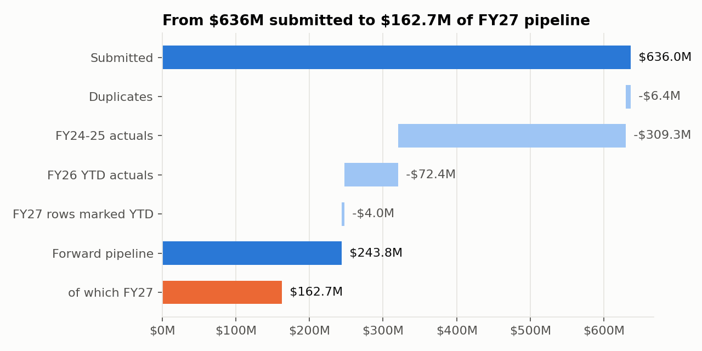
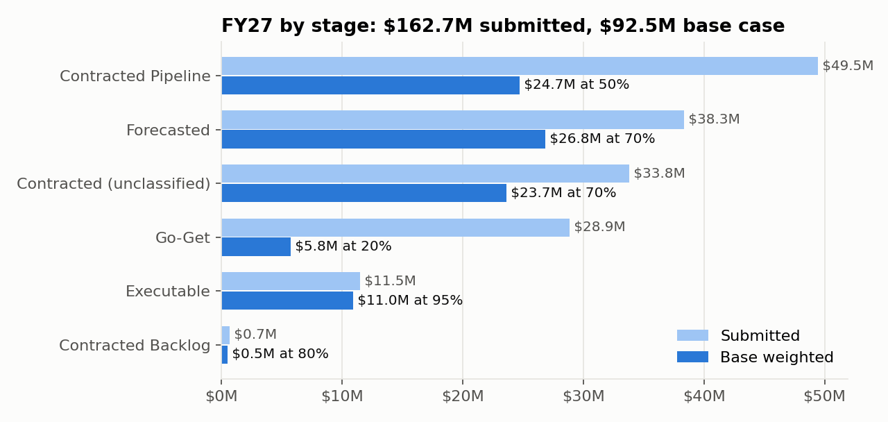
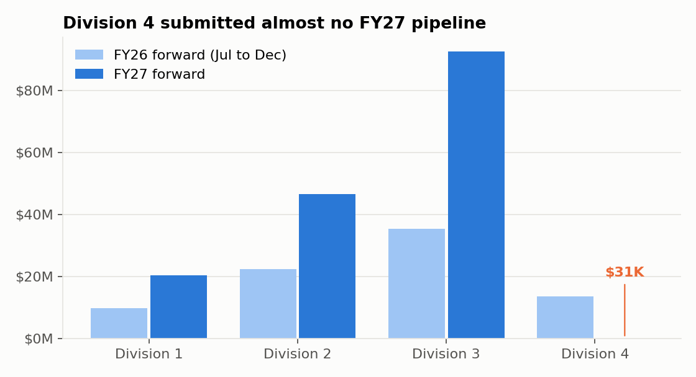
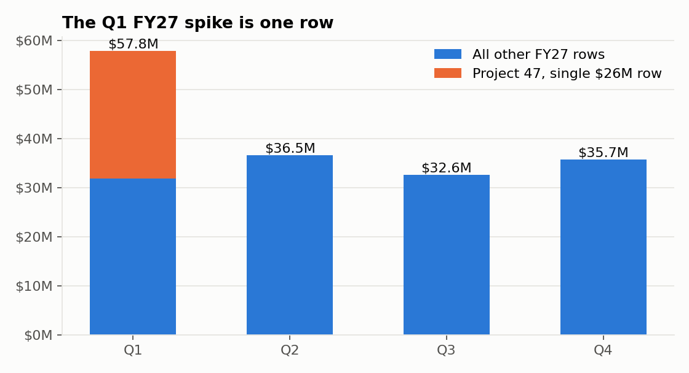

# FY27 Pipeline Review: from unvalidated divisional data to an operating plan number

A CFO asks for one number: how much of next year's pipeline should go into the FY27 operating plan. The input is 1,172 rows of revenue pipeline pasted together from four divisions that have never reported to a common standard. Nothing has been validated.

This repo is my answer to that case. I originally built it in Excel and Power Query with a CFO deck, then rebuilt the cleaning and every headline number in Python so each figure can be reproduced from the raw file with one command and is pinned by a test.



## The answer

| | FY27 |
|---|---|
| Submitted forward pipeline | **$162.7M** |
| Conservative, stage weighted | $70.7M |
| **Base case, stage weighted** | **$92.5M** |
| Upside, stage weighted | $114.3M |

**Recommendation:** plan on **$92.5M** from the submitted pipeline as a provisional figure, conditional on three things being resolved before sign off:

1. **Division 4 resubmits FY27.** It submitted $31,100 of FY27 pipeline against $13.7M of FY26 forward pipeline. That is almost certainly an incomplete submission, not a collapse in the business.
2. **The $33.8M "Contracted" bucket is mapped to a real stage.** 34 FY27 rows say only "Contracted", which matches none of the five stage definitions. I weighted them at 70% (same as Forecasted) and flagged the assumption.
3. **Customer 14 / Project 47 is validated.** One project is $33.8M, or 20.8% of FY27 pipeline, and a single $26M row in Q1 accounts for most of it.

**Counted:** every FY27 forward row, at its stage weight, including Go-Get, the unclassified Contracted bucket and three rows with no division.
**Not counted:** FY24 and FY25 actuals ($309.3M), FY26 actuals to date ($72.4M), FY26 forward pipeline ($81.2M), two FY27 rows labelled YTD ($4.0M), and 27 duplicate rows ($6.4M).

The weights are judgement calls read off the stage definitions (Executable 95%, Contracted Backlog 80%, Forecasted 70%, Contracted Pipeline 50%, Go-Get 20%). They are **not** measured conversion rates, because this dataset cannot produce conversion rates. See [what the data can and cannot answer](#what-the-data-can-and-cannot-answer).



## Key findings

**Division 4's FY27 submission is effectively empty.** 60 rows totalling $31,100. The same division also accounts for 92 of the 148 rows with no project ID.



**Concentration has shifted.** Customer 14 holds 31.2% of FY27 pipeline, replacing Customer 2 (47% of FY24 actuals, 14% of FY27 pipeline) as the largest exposure.

**The Q1 FY27 spike is one row.** Q1 is $57.8M against $32.6M to $36.5M in the other quarters. Remove the single $26M Project 47 row and Q1 looks like every other quarter.



**The trend is not readable yet.** FY24 $159.8M, FY25 $149.5M, FY26 estimated $136.7M (actuals to June plus weighted H2 pipeline). That looks like decline, but FY24 and FY25 are annual actuals, FY26 is half actual and half weighted pipeline, and FY27 is all weighted pipeline. Comparing them as a trend mixes three different measures.

## Data quality

The assignment required a fitness-for-purpose check before any number was presented. Fifteen issues found; full log with test method, treatment and headline impact in [docs/data_quality_log.md](docs/data_quality_log.md).

| Issue | Rows | Treatment | If missed |
|---|---|---|---|
| Exact duplicate block, Division 3 FY26 | 27 | Removed, kept in `duplicates_removed.csv` | FY26 overstated $6.4M |
| Revenue stored as text ("1,200,000") | 9 | Converted | Revenue understated $6.0M |
| "Contracted" matches no defined stage | 122 | Own bucket, weighted 70% | $33.8M of FY27 unweighted or guessed |
| Stage spelling variants (Go Get, GO GET, forecasted) | 136 | Standardised | Stage totals split |
| Customer 2 in three spellings | 84 | Standardised | Largest historical customer understated |
| FY27 rows labelled YTD | 2 | Excluded, question raised | $4.0M double counted |
| Missing project ID | 148 | Retained, flagged | Project level validation impossible |
| Quarter label disagrees with month | 7 | `Quarter_Clean` from month | $1.4M in the wrong quarter |
| Negative YTD actuals | 4 | Retained, flagged | Actuals overstated $1.3M if dropped |
| No division | 3 | "Unknown" bucket | $3.0M unattributed |

## What the data can and cannot answer

| CFO question | Answerable? | Why |
|---|---|---|
| How much FY27 pipeline, by stage, division, customer? | Yes | Stage, Division, Customer, Year, Revenue |
| How concentrated is it? | Yes | Customer, Project, Revenue |
| What is the stage to close conversion rate? | **No** | One snapshot, no opportunity ID, no outcome |
| How long do deals sit in a stage? | **No** | No date entered stage |
| Is revenue trending up or down? | Barely | Three years of actuals, mixed with pipeline |
| How accurate were past forecasts? | **No** | No prior pipeline snapshots |

To make those answerable, the divisions need a common submission template with an opportunity ID, a controlled stage list, expected close quarter, date entered stage and submission date. Two or three quarterly snapshots on that template would replace judgement weights with measured conversion.

**Proposed KPIs:** pipeline coverage vs. plan, stage conversion and velocity, forecast accuracy (prior weighted estimate vs. delivered revenue), submission completeness, and top 5 customer / project concentration.

## Reproduce it

```bash
pip install -r requirements.txt
python -m src.analysis   # prints the reconciliation and headline numbers, writes outputs/*.csv
python -m src.charts     # regenerates outputs/charts/*.png
pytest                   # 10 tests pinning every headline number
```

The Python rebuild matches the original Excel `Clean` tab row for row: same 1,145 rows, same division, customer, stage and quarter labels, same analysis class on every row.

## Repo layout

```
data/raw/pipeline_raw.csv        the 1,172 rows exactly as submitted
src/clean.py                     each cleaning rule, tagged to its data quality log entry
src/analysis.py                  reconciliation, stage weights, scenarios, concentration
src/charts.py                    README charts
tests/                           headline numbers as assertions
outputs/                         cleaned data, removed duplicates, summary tables, charts
docs/data_quality_log.md         15 issues: how found, how tested, what I did, what changes
docs/questions_for_divisions.md  what I could not resolve from the data alone
docs/ai_use.md                   where I used AI and how I checked it
original/                        the CFO deck as submitted (PPTX and PDF)
```

## Looking back

Things I would change or add now, with some distance from the deadline:

- **Test the 10x hypothesis on Project 47.** The Q1 FY27 row is $26,000,000; Q2, Q3 and Q4 for the same project are $2,600,000 each. That pattern looks like a keying error. If Q1 were $2.6M, FY27 pipeline would be $139.3M and the base case would fall from $92.5M to about $80.8M. I flagged the row for validation but did not call out the pattern, and it is the single most important question for the plan number.
- **Stop showing FY24 to FY27 as one trend line.** The executive summary put actuals, a blended estimate and a weighted pipeline figure side by side with percentage changes. The −32% to FY27 is a comparison of different measures, and the slide's own footnote says the decline is mostly a data problem.
- **Keep figures consistent across tabs.** A few numbers drifted between the Excel issue log and the deck (duplicates $6.3M vs $6.4M, negatives $1.2M vs $1.3M, Project 47 quoted once at the row level as $26M / 16% and once at the project level as $33.8M / 20.8%). The test suite now pins one value for each.

---
Case materials: the dataset is fully anonymised (Company A, Division 1 to 4, Customer 1 to 49). The original prompt is paraphrased here rather than reproduced.
